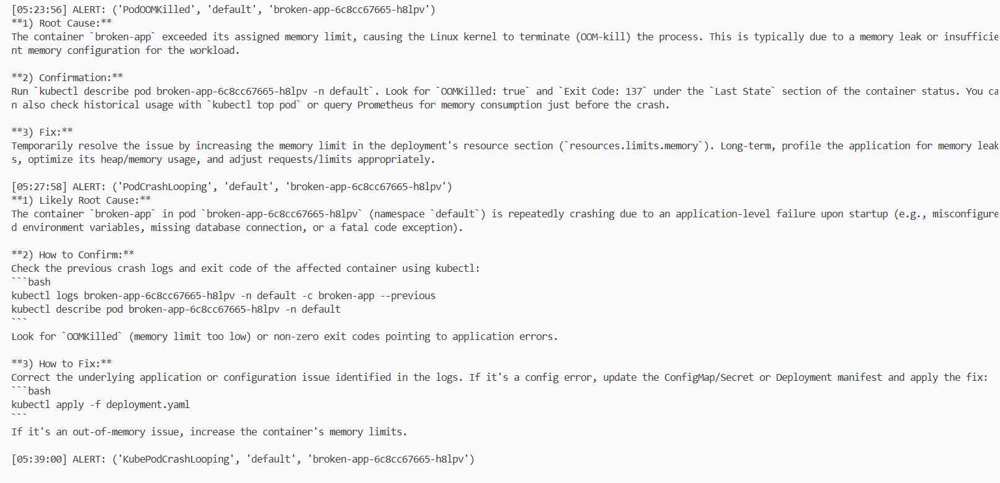
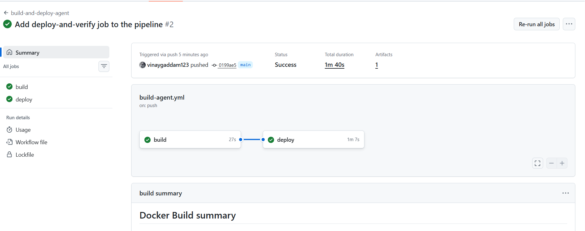

# AI SRE Agent

A small incident-response agent for Kubernetes. It polls Prometheus for firing alerts, sends each one to the Google Gemini API, and logs a root-cause analysis with steps to confirm and fix it.

> **Credit:** I built this by following Viswa Teja Payam's "AI SRE Agent" guide, typing and running every step myself in my own repo and Codespace, and adapting it where my environment differed. See "Differences from the guide" below.

## What it does

1. A deliberately broken app (`broken-app`) is deployed with a 10 MiB memory limit, so it gets OOMKilled and then goes into CrashLoopBackOff.
2. Prometheus (via kube-prometheus-stack) fires alerts such as `PodOOMKilled` and `PodCrashLooping`.
3. The agent (Python) polls `/api/v1/alerts` every 60 seconds, ignores noise alerts, and asks Gemini for a root-cause analysis.
4. The result is printed to the pod logs.

## Stack

k3d (k3s in Docker), Helm, kube-prometheus-stack (Prometheus and Grafana), Python, Google Gemini API, Docker, GitHub Actions, GitHub Container Registry.

## Repository layout

- `agent/` : the agent code, `requirements.txt` and `Dockerfile`
- `k8s/` : monitoring Helm values, the alert rules, the broken app, the agent deployment
- `.github/workflows/build-agent.yml` : builds the image and pushes it to GHCR on every change to `agent/`
- `screenshots/` : evidence of the running system

## Screenshots

## Problems I hit and fixed

- **k3d cluster never became ready:** containers on k3d's own Docker network had no internet access in Codespaces, so system pods could not pull images. Fixed by creating the cluster on Docker's default network with `--no-lb`.
- **Gemini calls returned 401 and 404:** the `AQ.` key returned `ACCESS_TOKEN_TYPE_UNSUPPORTED` on the ListModels call, and a malformed `.env` produced an empty model name. Fixed the `.env`, and used `generateContent` directly.
- **Gemini 503 and timeouts:** added retries with backoff and a shorter timeout, and switched to a lighter model.
- **No logs from the container:** Python buffered its output, so I set `PYTHONUNBUFFERED=1` in the Dockerfile.
- **Workflow never ran:** I had saved it outside `.github/workflows/`. Moved it.

## Differences from the guide

- Terraform / GCP VM deployment: not done. The agent runs in the local k3d cluster.
- Gemini model and request handling adapted to the current API.

## Possible improvements

The agent sends only the alert labels to Gemini, so the analysis is generic. Next step would be adding the pod's events and previous logs to the prompt.